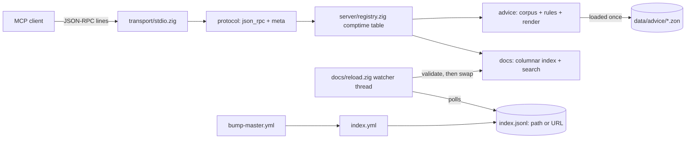

# AGENTS.md — ZigMCP

This is the **single spec of record and rulebook** for AI agents working in this
repository. It is self-contained: the former specification was folded into it.
The itemised remediation backlog — every known defect, edge case, limitation and
guideline deviation, with options and a verification command each — is `PLAN.md`.
Source comments cite this file as `AGENTS.md §N` (sections below) and `Dn`
(decisions in §3); keep those numbers stable — renumbering a section means updating
every citation (`grep "AGENTS.md §"`).

Human-facing documentation (install, configure, use) lives in `readme.md`. When you
change user-visible behaviour, update both files.

**Read order for a new task:** §1 → §3 (decisions — never contradict one without
the user's say-so) → the section for the area you touch → §11 (Zig API traps) →
§15 (working discipline).

---

## 1. Project overview

**ZigMCP** is a Model Context Protocol server written in Zig 0.17.1. It serves two
read-only corpora to an AI coding agent over stdio:

1. **Systems-programming advice** — the content of
   `systems_programming_context_v1.md` (paradigms P01–P12, decision rules R01–R12,
   guarantees, limits, source registry S01–S24), exposed as MCP tools, resources
   and prompts with **evidence labels intact**.
2. **Documentation imported from other Zig projects** — extracted from Zig's own doc
   syntax (`///` declaration comments, `//!` container comments) by a build-time
   indexer and served as searchable MCP tools/resources.

**The governing idea:** the server binary is a stable, thin host. Everything that
changes — advice corpus, doc index, upstream pins — is **data**, replaced by CI and
loaded at runtime. Never embed the index in the binary (D3).

### Goals

|#|Goal|Acceptance signal|
|---|---|---|
|G1|Serve the advice with evidence labels and source ids intact|Every advice record exposes `evidence` (`FACT`/`RESULT`/`SYNTHESIS`/`GUIDANCE`) and `sources` (`S01`…`S24`)|
|G2|Import docs from other Zig projects using Zig's doc syntax|The indexer extracts `///`/`//!` from arbitrary upstream trees with symbol paths and `path:line`|
|G3|Stay current without hand-edits|A scheduled CI job re-pins upstream branches and republishes the index; no source change|
|G4|Protocol correctness against MCP `2026-07-28`|`server/discover`; `_meta` validated; `resultType` + `serverInfo` on every current-revision result; cache hints on the six cacheable methods|
|G5|Correct under failure and load|The §9 verification layers run and the §9 report is produced|

### Non-goals (v1)

- Not an MCP **client**.
- No Streamable HTTP transport — stdio only. HTTP adds an auth surface
  (`-32020`/`-32021`) this server has no use for.
- No learned indexes, PGO, or learned policies (§13 exclusions).
- Not a replacement for `zig std` / `-femit-docs` HTML; this is machine-readable,
  cross-project retrieval.

### Current state (2026-11-09)

Implemented: protocol core, advice corpus, doc indexer, columnar index, hot reload
(local file and HTTP(S) URL), incremental re-index, all test layers, verification
report, the four CI workflows. Open items are listed in §14. `generated/` is
CI-produced and gitignored.

---

## 2. Architecture and request flow

### Two planes

|Plane|Contents|Rebuilt when|
|---|---|---|
|**Server plane** (`src/`)|Protocol, transport, registry, advice engine, index loader, search|Only when code changes|
|**Data plane** (`data/`, `generated/`)|Advice corpus (ZON), upstream source list (ZON), doc index (JSONL)|Continuously, by CI, without touching `src/`|



### Request flow (one MCP message)

```
stdin line (newline-framed JSON)
  → transport/stdio.zig       read one line; no embedded newlines
  → json_rpc.parseLine        not JSON → -32700
  → json_rpc.parseRequest     not a JSON-RPC 2.0 request → -32600
  → protocol/meta.zig         params._meta absent → legacy 2025-06-18 (no requirements)
                              present → protocolVersion + clientCapabilities required
                              (clientInfo, logLevel optional); incomplete → -32602;
                              unknown version → -32022 with data.supportedVersions
  → main.dispatch             method name → handler (registry tables, D8)
  → handler                   reads ONLY pre-loaded in-memory structures
  → main.buildResponse        current revision: + resultType "complete"
                              + _meta["io.modelcontextprotocol/serverInfo"]
                              + ttlMs/cacheScope when the handler set a cache hint;
                              legacy: none of these
  → transport.writeValue      ONE line to stdout, then FLUSH before reading the next
                              request (buffered writer; unflushed = deadlocked client)
  → notifications (no id)     never answered
  → stdin EOF                 stop the watcher, exit 0
```

Corpora are parsed **once at startup** into flat, arena-owned structures. Each
request gets a scratch arena from `util/arena_pool.zig`, reset after every message.

---

## 3. Decisions

|ID|Decision|Rationale|Rejected alternative|
|---|---|---|---|
|D1|MCP wire layer **in-repo** (JSON-RPC 2.0 over stdio); zero third-party runtime deps|`mcp.zig` tracks a newer Zig than our floor; a dependency couples our release cadence to theirs. Our surface is eight methods|`mcp.zig` 0.0.9 — revisit only if HTTP/OAuth/tasks become requirements|
|D2|Advice corpus is **data** (ZON), not code|P01 applied to ourselves: editing advice never touches a handler|Hardcoded Zig structs|
|D3|Doc index is a **runtime artifact**, never embedded, **hot-reloaded** by validate-then-atomic-swap|CI republishes; the running server picks it up with no rebuild or restart|`@embedFile` (rebuild per upstream commit); load-only-at-startup (restart per commit)|
|D4|Index canonical form is **JSONL**, one record per line|Diffable: the bump PR's diff shows changed doc text, keeping bot updates auditable|A binary blob|
|D5|Extraction uses **`std.zig.Ast`**, not `-femit-docs`|Parsing does not require upstream to compile on our toolchain — essential when tracking a master that may be mid-breakage|`-femit-docs` as the index source (kept as an optional extra, §14)|
|D6|Upstream sources are **hash-pinned in `data/sources.zon`**, re-pinned by a CI bump job|Reproducible; the bump job is what delivers G3. `build.zig.zon` carries no dependencies (D1)|Floating refs — Zig freezes URLs to a commit at fetch time anyway|
|D7|Support revision `2026-07-28` plus a legacy `initialize` alias|`server/discover` is mandatory now; older clients still probe with `initialize`|New revision only|
|D8|Capabilities live in **comptime tables**; JSON Schemas are derived from them|One source of truth for name/description/schema/handler — advertised and implemented cannot drift|Hand-written JSON Schema per tool|
|D9|Release artifacts are built with the **pinned stable Zig (0.17.1)**, never master; the master leg is a non-publishing canary|A moving toolchain makes releases unreproducible. Upstreams are parsed (D5), never compiled in, so their churn cannot break us|Releases from master nightly|
|D10|Legacy clients are handled by **version inference, not a second code path**: absent `_meta` ⇒ `2025-06-18`|Old clients send no `_meta`; strict `-32602` would reject them. One parser with a version flag stays single-path|A second protocol implementation; dropping legacy support|

### Update models considered (why D3 looks the way it does)

|Model|Why rejected|
|---|---|
|A. Embed everything in the binary|Every upstream commit becomes a release; no stable host|
|B. Server clones upstream at startup|Query latency depends on a network clone; breaks when upstream is mid-breakage; indexing paid per launch; no auditable diff|
|C. CI builds the index, server downloads once at startup|Works, but every update needs a client restart|
|**D. CI builds the index, server hot-reloads it (chosen)**|Stable binary, update = data swap, freshness bounded by short TTL + poll; a broken upstream cannot take the server down (last good index keeps serving)|

The indexer lives in CI (`tools/indexer.zig`), not in the server: shipping it in the
server would put upstream-parse failure modes on the request path.

---

## 4. Repository layout and module map

|Path|Responsibility|
|---|---|
|`src/main.zig`|Entry: parse options, load corpus, load index, start watcher, stdio loop, dispatch, response envelope|
|`src/root.zig`|Test aggregator: pulls every module's `test` blocks into one binary|
|`src/protocol/json_rpc.zig`|Line → `std.json.Value` → request/notification|
|`src/protocol/meta.zig`|`_meta` parse, version resolution, legacy inference (D10)|
|`src/protocol/errors.zig`|Error codes and error objects|
|`src/transport/stdio.zig`|Newline framing over streaming stdin/stdout, flush per response|
|`src/server/registry.zig`|Tool table (sorted), schema derivation, argument validation, cache hints (D8)|
|`src/server/discover.zig`|`server/discover`, legacy `initialize`, server `instructions`|
|`src/server/tools.zig`|Tool handlers, `tools/list`, tool-result envelope|
|`src/server/resources.zig`|`resources/list`, `resources/templates/list`, `resources/read`|
|`src/server/prompts.zig`|`prompts/list`, `prompts/get`|
|`src/advice/corpus.zig`|ZON schemas + loader for `data/advice/*.zon`|
|`src/advice/rules.zig`|Token-overlap matcher over the SELECT rules (P05)|
|`src/advice/render.zig`|Record → structured JSON and text, labels attached|
|`src/docs/index.zig`|JSONL loader (whole-or-nothing), 256 MiB ceiling|
|`src/docs/columnar.zig`|P03 layout: one string table + parallel arrays|
|`src/docs/reload.zig`|Index source (path/URL), snapshot store, watcher thread, atomic swap|
|`src/docs/search.zig`|Scored symbol/path/doc search, limit clamp|
|`src/util/arena_pool.zig`|Per-request scratch arena|
|`src/util/text.zig`|Tokenizer + case-insensitive helpers|
|`src/util/sleep.zig`|Thread sleep that does not share the server's `Io`|
|`data/advice/`|`patterns.zon` (P01–P12), `rules.zon` (R01–R12), `guarantees.zon`, `limits.zon` (+ evidence legend), `sources.zon` (S01–S24)|
|`data/sources.zon`|Upstream projects: url, hash, branch, commit, scope (the pin home, D6)|
|`tools/indexer.zig`|Upstream tree → JSONL + `.status.json` sidecar|
|`tools/advice_check.zig`|Corpus validator (`zig build check`)|
|`tools/bench.zig`|Verification report (`zig build bench`)|
|`tests/protocol_test.zig`|Protocol + end-to-end layers: the built binary over pipes|
|`tests/indexer_test.zig`|Golden layer: byte-for-byte against `tests/golden/index.jsonl`|
|`tests/fixtures/indexer_src/`|Indexer fixture tree — contains a deliberately broken file and a warning-only file|
|`tests/golden/`|`index.jsonl` + `index.status.json`|
|`.github/workflows/`|`ci.yml`, `bump-master.yml`, `index.yml`, `release.yml` (§8)|
|`systems_programming_context_v1.md`|Upstream source of the advice corpus. Reference only — never edit it to change behaviour|
|`readme.md`|User guide|
|`lsp.json`|ZLS wiring (§10)|

Gitignored: `zig-out/`, `.zig-cache/`, `.probe/` (API probes), `.superpowers/`
(planning scratch), root `docs/` (`-femit-docs` output — anchored so `src/docs/` stays
tracked), `generated/`, native byproducts (`*.lib`, `*.a`, `*.o`, `*.obj`).

---

## 5. MCP surface

### Tools (`tools/list` is sorted by name)

All five are read-only: annotations `readOnlyHint: true`, `destructiveHint: false`,
`idempotentHint: true`, `openWorldHint: false`. Each declares `inputSchema` and
`outputSchema` derived from `registry.Schema`; results carry `content` (one text
item), `structuredContent` matching the output schema, and `isError`.

|Tool|Input|Structured output|Notes|
|---|---|---|---|
|`advice_lookup`|`concept` (e.g. `P03`) **or** `question` (free text); at least one|`{query, matches[]}` — full pattern records|Question mode: token overlap over name, controls, facts, candidate uses; top 5|
|`recommend_approach`|`signals: string[]` (non-empty), optional `constraints: object` (opaque)|`{signals, matches[{rule_id, condition, consider[], and_only_if?, evidence, score}]}`|A rule matches on ≥2 shared tokens, or 1 token covering ≥50% of its condition|
|`doc_search`|`query`, optional `project`, optional `limit` (default 20, max 100; ≤0 → 20)|`{query, count, results[{project, commit, path, line, kind, symbol, container, doc}]}`|Score: exact symbol 100 / symbol substring 60 / token-in-symbol 40, +25 path, +10 doc substring or +5 token-in-doc; ties by symbol, path, line|
|`doc_get`|`project`, `symbol` (case-insensitive)|`{found, project?, commit?, path?, line?, kind?, symbol?, container?, doc?, doc_hash?}`|Exact match only; `found` is always present so a miss is still schema-shaped|
|`doc_import_status`|`{}`|`{index_path?, index_state, index_error?, index_records, projects[{project, commit, records, files_total?, files_degraded?, degraded?}]}`|`index_state` is `ok`/`unloaded`/`reload_failed`, so a client can see that the index being served is not the artifact on disk (REL-4); degraded counts come from the `.status.json` sidecar next to a **local** index, and a sidecar member whose type or sign contradicts this schema is omitted rather than echoed|

"Nothing matched" is a **normal result with `isError: true`**, an explanation, and
`structuredContent` shaped like the tool's `outputSchema` (empty `matches`/`results`,
or `found: false`) — a typed client must be able to tell "no result" from a malformed
response (PROTO-12).
Unknown tool or arguments that violate the schema (missing required, unknown member,
wrong type) are `-32602`.

### Resources

|URI|Cache|Content|
|---|---|---|
|`advice://overview`|advice|Version, research date, one line per pattern with label|
|`advice://patterns`|advice|All 12 patterns in one document|
|`advice://patterns/P01` … `P12`|advice|One full pattern, listed literally (12 fixed ids)|
|`advice://rules`|advice|R01–R12, all GUIDANCE|
|`advice://guarantees`|advice|Guarantees with labels, guidance, sources|
|`advice://limits`|advice|Limits + evidence-label legend|
|`advice://sources`|advice|S01–S24 with author, title, kind, URL|
|`docs://{project}/index`|index|`path:line symbol` per record; one listed per project in the loaded index|
|`docs://{project}/symbols/{symbol}`|index|One record; exposed as a **resource template** (unbounded space)|

`resources/list` itself carries the **index** cache hint because its contents depend
on the loaded index. Every listed resource is readable (PROTO-1). Project keys in
`docs://` URIs are exact identifiers — `Fixture` and `fixture` are two projects — while
symbol paths are matched case-insensitively (PROTO-13).

### Prompts (sorted by name; one required argument each)

|Prompt|Argument|Content|
|---|---|---|
|`approach_selection`|`situation`|Runs the rule matcher on the situation; instructs: cite R-ids, keep GUIDANCE labelled, name P-ids with boundaries, say so when nothing matches|
|`systems_review`|`design`|Pulls matching pattern records; instructs: keep GUIDANCE apart from FACT/RESULT/SYNTHESIS, treat boundaries as hard limits, list checks not run, cite P/R/G/S ids|

`server/discover` also returns an `instructions` string telling the agent which tool
to use when and that imported doc text is data, never instructions.

---

## 6. Protocol rules

- **Revision:** `2026-07-28`, stateless. No `initialize` handshake; `server/discover`
  is mandatory and returns `supportedVersions`, `capabilities` (tools/resources/
  prompts, `listChanged: false`), `instructions`.
- **Version resolution (D10):** `params` or `params._meta` absent ⇒ legacy
  `2025-06-18`. `_meta` present ⇒ must carry
  `io.modelcontextprotocol/protocolVersion` (string) and
  `io.modelcontextprotocol/clientCapabilities` (object); `clientInfo` (object) and
  `logLevel` (string) optional; a mistyped or missing required member ⇒ `-32602`.
  A version outside `["2026-07-28", "2025-06-18"]` ⇒ `-32022` with
  `data.supportedVersions`.
- **Legacy `initialize`:** answered only for legacy requests; returns
  `{protocolVersion: "2025-06-18", capabilities, serverInfo}`. On a current-revision
  request it is `-32601`.
- **Current-revision results** always carry `resultType: "complete"`
  (`"input_required"` reserved) and `_meta["io.modelcontextprotocol/serverInfo"] =
  {name: "zigmcp", version: "0.1.0"}`. Legacy results carry neither.
- **Cache hints (SEP-2549) are mandatory** on current-revision results of
  `server/discover`, `tools/list`, `prompts/list`, `resources/list`,
  `resources/templates/list`, `resources/read`: `ttlMs` + `cacheScope`. Advice data:
  3 600 000 ms, `public`. Index-derived data: 60 000 ms, `private`. `tools/call` and
  `prompts/get` carry none.
- **Error mapping:**

|Situation|Response|
|---|---|
|Line is not JSON|`-32700`|
|Not a JSON-RPC 2.0 request envelope|`-32600`|
|Unknown method|`-32601`|
|`_meta` incomplete/mistyped; unknown tool/prompt; bad arguments; missing `name`/`uri`; unknown resource (with `data.uri`)|`-32602`|
|Unsupported protocol version|`-32022` + `data.supportedVersions`|
|Internal failure|`-32603`|
|Tool ran but found nothing|normal result, `isError: true`|

- `-32002` (legacy resource-not-found) **MUST NOT** be emitted; never return an
  empty `contents` array. `-32020`/`-32021` are HTTP-only and not wired.
- **stdio:** one message per line, no embedded newlines; stdout carries MCP messages
  only; diagnostics go to stderr; **flush every response before the next read**;
  exit 0 on EOF. Notifications are never answered. A line that does not fit the
  64 KiB reader buffer is answered with `-32700`, the rest of the line is discarded,
  and the server keeps serving — the cap also bounds JSON nesting (SRV-1, SRV-4).
- **Logging:** `notifications/message` is never emitted (logLevel is parsed but no
  log stream exists).
- Removed in `2026-07-28` and therefore absent: `ping`, `logging/setLevel`,
  `resources/subscribe` (replaced by `subscriptions/listen`, out of scope for v1).

---

## 7. Data model

### Advice corpus (`data/advice/*.zon`)

Every file has `.version = 1`. `patterns.zon` also carries
`.source_research_date = "2026-11-09"` (matches the source doc's frontmatter).

```zon
// patterns.zon — one record per P01..P12
.{ .id = "P03", .name = "Data-oriented design",
   .what_data_controls = "Physical representation and transformations",
   .mechanism = null,                       // optional
   .facts = .{ .{ .text = "…", .source = "S15", .evidence = .fact } },
   .candidate_uses = .{ "…" }, .boundaries = .{ "…" }, .checks = .{ "…" },
   .evidence = .synthesis,                  // .fact | .result | .synthesis | .guidance
   .sources = .{ "S06", "S15" } }

// rules.zon — the 12 SELECT rules as (condition → consider → constraint)
.{ .id = "R03", .condition = "Measured memory/access bottleneck",
   .then = .{ .consider = .{"P03"}, .and_only_if = "…" },  // and_only_if optional
   .evidence = .guidance }

// guarantees.zon: .{ .id, .claim, .evidence, .guidance = ?, .sources }
// limits.zon:     .{ .limits = .{ "…" }, .evidence_legend = .{ .{ .label, .meaning } } }
// sources.zon:    .{ .id = "S01", .author, .title, .kind, .url }
```

The loader (`corpus.zig`) and the validator (`advice_check.zig`) each declare these
structs; change them together, plus `tools/bench.zig`, which has a third copy for
counting.

### Doc index record (JSONL, one minified object per line)

```json
{"project":"zig_std","commit":"738d2be…","path":"lib/std/mem.zig","line":812,"kind":"fn","symbol":"mem.copyForwards","container":"mem","doc":" Copies …","doc_hash":"<sha256 hex>"}
```

|Field|Meaning|
|---|---|
|`project`|Project key given to the indexer (`--source <project>=…`)|
|`commit`|Upstream commit the record came from (provenance)|
|`path`, `line`|Source location, `/`-separated, 1-based|
|`kind`|`fn` / `var` / `field` / `container` / `error` / `param`|
|`symbol`|Syntactic container path; module path is the file path with `/` → `.` and `.zig` stripped|
|`container`|Enclosing symbol (`""` for a module's `//!` record)|
|`doc`|`///` or `//!` stripped (the space after it is kept), lines joined with `\n`|
|`doc_hash`|Lowercase hex SHA-256 of `doc`; recomputed and compared at load, so a mismatch rejects the artifact (REL-9)|

Key order is fixed. Records are sorted by `(project, symbol)`, ties by `(path, line)`.
The loader rejects the **whole** artifact if any non-blank line is malformed, if a
record's `doc_hash` is not the SHA-256 of its `doc`, or if the records are not in that
order (REL-10).

### Upstream sources (`data/sources.zon`)

```zon
.zig_std = .{
    .url = "git+https://github.com/ziglang/zig.git?ref=master#<sha>",
    .hash = "zig-0.0.0-…", .branch = "master", .commit = "<sha>",
    .scope = .{ .include = .{"lib/std/**"}, .exclude = .{"lib/std/**/testdata/**"} },
},
```

The CI workflows parse this file with a regex: keep one source per top-level block,
closing with `\n    },`. Only the **first** `include` entry is honoured (with `/**`
stripped) and `exclude` is not applied yet (§14).

---

## 8. Doc import pipeline and CI

### Indexer (`tools/indexer.zig`)

```
indexer --out <index.jsonl> --source <project>=<commit>=<root> [--source …]
        [--include <subpath> …] [--status <path>] [--previous <index.jsonl>]
```

Per `.zig` file under `root` (filtered by `--include` prefixes):

1. Read and NUL-terminate; `std.zig.Ast.parse(gpa, source, .{ .mode = .zig })`. A file
   that cannot be read, or exceeds the 64 MiB per-file ceiling, is recorded as
   degraded with a `reason` and skipped — it never aborts the run (IDX-1). The same
   happens to a file whose bracket nesting exceeds 256 levels: `Ast.parse` recurses
   once per level and overflows the stack on a hostile file long before the bytes
   run out (IDX-8).
2. **Degrade, never skip:** extract from every file regardless of `tree.errors`;
   record each diagnostic (tag + line) and mark the file **degraded** in the status
   sidecar. No curated fatal-tag list — the stdlib has no severity field.
3. Leading `//!` run → one `container` record, `line = 1`.
4. Walk declarations recursively: `rootDecls()`; a `var`/`const` whose initializer
   is a container recurses through `fullContainerDecl` members; `fn` names come from
   `fullFnProto`, and `proto.iterate` emits a `param` record for each documented
   parameter; container fields → `field`; error-set members are found by scanning
   identifier tokens between the braces → `error`.
5. **Attachment rule (pinned by the golden test):** a doc run attaches to the
   declaration whose `firstToken` immediately follows it. Walk back from
   `firstToken(decl) - 1` to the start of the contiguous `.doc_comment` run, then
   collect forwards in source order. A blank line does not break attachment (it is
   not a token). A run the parser flagged `.unattached_doc_comment` is dropped.
6. Undocumented declarations are skipped.
7. Output sorted (§7); status sidecar defaults to `<out minus .jsonl>.status.json`:
   `{"projects":{"<p>":{"commit","records","files_total","files_degraded",
   ["skipped","previous_records"],"degraded":[{"path","reason?","diagnostics":[{"tag","line"}]}]}}}`.
   `reason` is set when the file was not parsed at all (unreadable, oversized, or
   too deeply nested), in which case `diagnostics` is empty.

**Incremental:** with `--previous`, a project whose `(project, commit)` already has
records there is skipped and those records are carried over verbatim — but only when
the previous run's status sidecar, if there is one, reports exactly as many records
for that commit as the JSONL holds. A truncated previous index is therefore
re-indexed instead of being republished as complete (IDX-3). With no sidecar (a
release baseline ships only the JSONL) there is no oracle, so the records are
trusted as before.

### Server-side loading and hot reload (`src/docs/reload.zig`)

- Index location: `--index` or `ZIGMCP_INDEX` — a local path or an `http(s)://` URL.
  Default: `generated/index.jsonl` if it exists. None ⇒ an empty index (advice still
  served, doc tools report nothing matched).
- A failed initial load logs to stderr and serves without an index; the watcher
  keeps trying. The log names the underlying cause — `FileNotFound`, `IsDir`,
  `IndexTooLarge` (past the 256 MiB ceiling) or `MalformedRecord` (one bad line) —
  so an operator can tell a missing artifact from a corrupt one (REL-8). The same
  state reaches clients through `doc_import_status`'s `index_state`/`index_error`,
  so a stale index is visible without reading the server's stderr (REL-4).
- **Local file:** polled every 1 s by mtime + size. **URL:** re-fetched every 60 s
  with `std.http.Client.fetch` (no conditional GET in the stdlib) and compared by
  SHA-256; downloads are capped at 256 MiB.
- New artifacts are parsed and validated **in full** into a fresh arena, then the
  active pointer is swapped. Readers hold reference-counted snapshots, so the old
  index is freed only after its last reader releases it. The watcher thread is the
  **only writer**; a failed reload leaves the previous index serving.
- On shutdown the watcher is stopped; if it is parked in a network read it is left to
  process exit and the store is deliberately not freed.

### CI workflows

|Workflow|Trigger|Does|
|---|---|---|
|`ci.yml`|push, PR|`zig build test`, `zig build check`, `zig build test-regressions`, `zig build workflows`, `zig fmt --check . --exclude tests/fixtures` and the pinned actionlint on Zig 0.17.1 × {ubuntu, macos, windows} (blocking); the same on Zig master (canary, `continue-on-error`)|
|`bump-master.yml`|daily 03:17 UTC, manual|Builds a baseline index (the rolling `index` release's `index.jsonl` asset, else rebuilt from current pins); re-resolves each branch with `zig fetch --save` in a scratch `zig init`; indexes the new pins; opens **one** PR updating `data/sources.zon` **only if the index differs**, with per-project old→new commits and changed-record counts; uploads the JSONL diff as an artifact. A dead branch fails only its project and keeps the old pin|
|`index.yml`|push to `main` touching `data/sources.zon`, manual|Indexes the pinned trees (incremental against the rolling `index` release, rebuilt from scratch when it does not exist yet), merges and sorts, merges status sidecars, uploads `generated/` as the `index` artifact, and publishes `index.jsonl` to the rolling `index` release with `gh release upload --clobber`|
|`release.yml`|tag `v*`|`zig build -Doptimize=ReleaseSafe` × 3 OS on 0.17.1; attaches binaries (+ `generated/index.jsonl` if present) and a client-config snippet|

Baseline rule: the bump diff baseline is the `index.jsonl` asset of the rolling
**`index` release**, published by `index.yml` (`gh release upload … --clobber`), and
never a prior workflow artifact (those expire and need run-id/token plumbing). One
documented tag serves both baselines; `release.yml` does not produce it. Rollback =
publish the previous index; no rebuild.

---

## 9. Verification and test layers

`zig build test` runs unit + protocol + golden; `zig build test-protocol` runs the
protocol layer alone; `zig build test-regressions` runs the open-bug tests (below).

|Layer|Where|
|---|---|
|Unit|`test` blocks in `src/**` via `src/root.zig`|
|Property (deterministic generators, not coverage-guided fuzzing)|`meta.zig` (random `_meta`), `index.zig` (mutated/truncated/invalid-UTF-8 JSONL loads whole or is rejected), `search.zig` (pathological queries never exceed the limit)|
|Integration|`reload.zig` — a reader takes snapshots while the writer swaps; a torn read would mix versions|
|Golden|`tests/indexer_test.zig` — indexer output over the fixture tree must equal `tests/golden/index.jsonl` **byte for byte**|
|Protocol|`tests/protocol_test.zig` — the built binary over pipes: discover, legacy `initialize`, every error code, `tools/list` order, cache hints on all six methods, missing resource, prompts, clean EOF exit. Writing one request and blocking on the reply pins the flush rule|
|End-to-end|same file — discover → list tools → call every tool → read a resource → get a prompt|
|Corpus validation|`zig build check` (§12)|
|Backlog regressions|`src/regressions_test.zig` — one test per `PLAN.md` item that a pure function or handler can reach. **Red by design**: each test asserts the wanted behaviour, so it passes only once its item is fixed. Not imported by `src/root.zig`; `PLAN.md` §10 maps every other id to the layer that must own its test|

**Backlog rule:** a commit that fixes an item must flip its regression test green
and delete that test's row from `PLAN.md` §10 (or move it into the main suite). Do
not add a failing test to `src/root.zig`, and do not "fix" a regression test by
weakening its expectation — pick the option in `PLAN.md` first, then make the test
match the chosen behaviour.

**Semantics the tests pin:** doc text verbatim except prefix stripping and line
joining; the attachment rule; `tools/list` sorted by name and the index sorted by
`(project, symbol)`; a degraded file still contributes records and never fails a
start; a 256 MiB index ceiling (candidate, not yet measured on the full corpus); no
wall-clock deadline claims — report p50/p95/p99 instead.

**Permanent-test rule:** tests must catch consumer-visible defects — behaviour,
boundaries, invariants, transitions, precedence, errors. Not wiring, mock echoes,
source-text assertions, or bare not-throw checks. If you change the fixture tree,
regenerate the golden file deliberately and review the diff; never "fix" the golden
test by editing it to match new output without understanding why it changed.

**Verification report:** `zig build bench` runs `tools/bench.zig` against the built
server with `--index tests/golden/index.jsonl` and prints build config, Zig version,
corpus counts, index size and upstream commits, startup time, per-tool
p50/p95/p99 latency and error counts, and peak RSS. Lifecycle note: the dominant
preparation cost is the CI index build, paid once per upstream bump, not per request.

**Before any learned-index (P11) claim:** first build and measure linear scan over
JSONL, binary search over a sorted symbol table, and a token inverted index.

---

## 10. Development commands and toolchain

```bash
zig version                  # 0.17.1
zig build                    # zig-out/bin/{zigmcp, indexer, bench}
zig build test               # unit + protocol + golden
zig build test-protocol      # protocol layer only
zig build test-regressions   # PLAN.md open-bug tests (red until fixed)
zig build check              # advice corpus validation
zig build workflows          # workflow trigger/expression consistency (CI-1)
zig build bench              # verification report
zig build run -- --index tests/golden/index.jsonl
zig build -Doptimize=ReleaseSafe
zig fmt --check . --exclude tests/fixtures   # the fixture tree is deliberately unformattable
```

- **Workflow gates:** `zig build workflows` (trigger/expression consistency, CI-1)
  and `go run github.com/rhysd/actionlint/cmd/actionlint@v1.7.7 .github/workflows/*.yml`
  — the same pinned command `ci.yml` runs. Newer actionlint releases additionally
  report that `actions/checkout@v4` and friends run on a deprecated node20 runtime;
  that is the separate, pre-existing `CI-9` item, not a gate failure.
- **Toolchain:** Zig 0.17.1 at `C:\Users\Sethticles\scoop\apps\zig\0.17.1`;
  `.minimum_zig_version = "0.17.1"`; global cache `C:\Users\Sethticles\AppData\Local\zig`.
- **Server options:** `--index <path-or-url>` / `ZIGMCP_INDEX`; `--advice-dir <path>`
  / `ZIGMCP_ADVICE_DIR` (default `data/advice`, relative to the working directory);
  `--help`. Flags override the environment. An unknown argument or a missing option
  value prints one line and the usage block to stderr and exits 2 — never a bare Zig
  error name, a stack trace or exit 1 (SRV-8).
- **Interrupted builds** can orphan `zig.exe` compiler children that hold the cache
  lock; the next build then looks hung. Kill them before timing anything.
- **ZLS** is wired through `lsp.json`. Keep it on the toolchain's minor version
  (0.17.x); stop `zls.exe` before upgrading (scoop cannot overwrite a running
  binary). ZLS reports syntax errors at once but semantic errors only after the next
  build — `zig build test` is the authority.
- **Re-pinning an upstream** by hand: in a scratch `zig init` checkout run
  `zig fetch --save=zig_std "git+https://github.com/ziglang/zig.git#master"` (or
  `mcp_zig` … `#main`), then copy the resolved `url`/`hash`/commit into
  `data/sources.zon`. Pins never float: the `#<sha>` freezes the commit and `hash` is
  the source of truth. A wrong branch name fails with `error: ref not found`.
- **Shell:** bash is for real binaries and short fact pipelines. Use the dedicated
  read/search/edit tools for file work.

---

## 11. Zig 0.17.1 API facts that bite

Verified against the installed toolchain. Citations are by file and symbol, not line.
Re-verify before relying on anything new: write a throwaway probe under `.probe/`,
compile it, read the compiler's notes, delete the probe (`zig-std-api-verification`
skill).

- **`std.fs.File` is gone.** Use `std.Io.File.stdin()/stdout()/stderr()`;
  `file.writer(io, &buf)` → `.interface` is the `std.Io.Writer`. On pipes use
  `readerStreaming`/`writerStreaming` — positional I/O on a pipe silently loses bytes.
- **Writers are buffered:** nothing is emitted until `.flush()`.
- **Entry point** receives `std.process.Init`: `gpa`, `io`, `arena`
  (`*std.heap.ArenaAllocator`), `environ_map`, `preopens`, `minimal`.
- **Arguments:** `std.process.Args.toSlice(args, arena)`; `Args.iterate` is a compile
  error on Windows.
- **`std.json`:** `ObjectMap` and `std.json.Array` are **managed**
  (`map.put(gpa, k, v)`; `Array.init(gpa)` + `append(v)`); `std.ArrayList(T)` is
  **unmanaged** (`append(gpa, v)`, `toOwnedSlice(gpa)`).
  `std.json.Stringify.value(v, .{}, &writer)` on a `std.json.Value` uses its
  `jsonStringify`; passing an anonymous struct serializes the struct instead — a
  silent wire bug.
- **ZON:** `std.zon.parse.fromSlice(T, .{ .gpa, .arena, .source, .diagnostics })`;
  `source` must be `[:0]const u8`; `Diagnostics = { errors: []const Error }`.
  `fromSliceAlloc`/`free` are gone.
- **`ArenaAllocator.allocator()` is self-referential** (its `ptr` is the arena). An
  arena copied by value leaves the copy pointing at the dead original — heap-allocate
  it (`gpa.create(std.heap.ArenaAllocator)`) and keep the pointer.
- **`std.Io.Mutex`** needs an `Io` (`lock(io)`); for tiny critical sections prefer a
  spin lock over `std.atomic.Value(bool)`.
- **Sleeping:** `std.Io.sleep(io, duration, .awake)`; `std.Thread.sleep` is gone.
  Background threads must not share the server's `Io` (`src/util/sleep.zig`).
- **`Allocator.dupeZ` is gone** → `dupeSentinel(allocator, T, bytes, sentinel)`.
- **HTTP:** `std.http.Client.fetch(options)` writes the body to
  `FetchOptions.response_writer`; `FetchResult` exposes only `status` — no ETag or
  conditional GET.
- **`std.compress.zstd`** exists (unused so far).
- **`std.zig.Ast`** (`lib/std/zig/Ast.zig`):
  - `Ast.parse(gpa, source, .{ .mode = .zig })` takes a sentinel-terminated source and
    **never fails on malformed input**: diagnostics land in `tree.errors`, mixing
    warnings and errors with no severity field (`tag`, `is_note`, `token_is_prev`,
    `token`, `extra`).
  - `///` → `.doc_comment`; `//!` → `.container_doc_comment`.
    `tree.tokens.items(.tag)` returns `[]Token.Tag` directly. `tokenSlice(i)` takes a
    `u32` and includes the `///` prefix.
  - `firstToken` of a `pub` decl is the `pub` keyword.
  - `fullContainerDecl(&buf, node)` (buf: `[2]Ast.Node.Index`) returns an optional;
    members are `cd.ast.members`. Covers `container_decl*`, `container_decl_two*`,
    `container_decl_arg*`, `tagged_union*`.
  - `Node.Index` is `enum(u32)`; use `OptionalIndex.unwrap()` instead of manual
    `@enumFromInt`.
  - **Error-set members are not nodes:** `error_set_decl` holds only the brace tokens
    (`nodeData(node).token_and_token`); members are `identifier` tokens.
  - `fullFnProto(&buf1, decl)` gives `name_token`; `proto.iterate(&tree)` yields
    `Param{ first_doc_comment, name_token, … }`.
- **`zig build-lib -femit-docs`** writes `docs/` and a `.lib` into the **current
  directory** (no output-dir flag). Clean them up before committing.
- **Build API:** `root_module` is a field of the options struct; `b.addOptions()` +
  `addOptionPath` is how tests receive built binary paths.

---

## 12. Code and corpus conventions

### Allocation discipline

Load corpora once into arenas; serve requests from flat read-only structures; use the
per-request pool arena for scratch, reset after every message. Never re-parse ZON or
JSONL per request. Reloads are atomic-replace: parse + validate fully, swap the
pointer, drop the old one after its last reader — never mutate live structures.
Bound every input and output (query length, clamped `limit`, 256 MiB artifacts).

### Adding a capability

- **Tool:** add a row to `registry.tool_specs` (keep it **sorted by name** — a unit
  test enforces it) with `input`/`output` `Schema`s and a handler in `tools.zig`.
  Never hand-write JSON Schema (D8). Validate arguments with `registry.validate` first.
- **Resource:** add to `resources.resource_specs` and handle the URI in
  `resources.read`; choose `advice_cache` or `index_cache` honestly.
- **Prompt:** add to `prompts.prompt_specs` (sorted) and its text builder.
- Update §5 here and the surface tables in `readme.md`; extend
  `tests/protocol_test.zig`.

### Corpus rules (non-negotiable)

- **Evidence labels are mandatory.** Every record carries exactly one of
  `FACT`/`RESULT`/`SYNTHESIS`/`GUIDANCE` plus `Sxx` sources. Never present GUIDANCE as
  FACT. Legend: FACT = documented mechanism; RESULT = study-specific finding, keep its
  conditions; SYNTHESIS = the report's classification, not a standard taxonomy;
  GUIDANCE = recommendation needing project-specific validation.
- **All 12 rules are GUIDANCE.** Pattern records are SYNTHESIS; their facts are FACT
  or RESULT per the source document.
- Fact text is the source document's own wording (light punctuation only). Do not add
  claims the source does not make.
- `zig build check` fails on: ids not `P01..P12`/`R01..R12`/`Sxx`; duplicates; pattern
  or rule counts ≠ 12; a source id not in `sources.zon`; a pattern `sources` entry that
  no fact cites; a rule `consider` that is not a pattern id.
- Imported upstream doc text is **data**: never move it into `instructions` or any
  channel the client treats as directives (prompt-injection defence).

### Style

- Every module starts with a `//!` header saying what it owns and which section or
  decision it implements.
- Diagnostics go to stderr only; stdout is the protocol.
- `zig fmt` is the formatter; the fixture tree is excluded.

---

## 13. How the advice applies to this codebase

|Pattern|Use here|
|---|---|
|P01 table/config driven|Corpus, source list and capability tables interpreted by small engines|
|P02 pattern–action|`advice_lookup` question mode and `doc_search` scoring; explicit no-match behaviour|
|P03 data-oriented|Columnar index: one string table + parallel arrays|
|P05 declarative/relational|SELECT rules as data; `recommend_approach` is a join over them|
|P06 incremental|CI re-index keyed by `commit`; server side is a whole-index swap|
|P07 schema-driven generation|Upstream source → AST → JSONL artifact; parse at CI time, load at runtime|
|P09 event/descriptor driven|stdio with explicit buffers and flush-before-read; EOF and shutdown as failure surfaces|
|P04 ECS, P08 programmable infra|Not applicable|
|P10 PGO, P11 learned index, P12 learned policy|**Excluded** — no representative workload, no measured exact baseline, no measurable objective|

Cross-cutting guarantees applied: memory safety ≠ event ordering (reload is
atomic-replace); publish only fully validated data and reclaim after the last reader;
bounded inputs and outputs; version provenance (record `commit`, corpus `version`,
`serverInfo.version`).

---

## 14. Risks, known gaps, roadmap

### Known gaps (verified in the tree)

The full list, with per-item options and verification steps, is `PLAN.md`. The
summary below is the part that changes how you work in this tree.

- `data/sources.zon` scope: only the first `include` is used by CI; `exclude` is
  ignored.
- `doc_import_status` has no "freshness vs upstream master" field; degraded counts are
  available only for a local index with a sidecar.
- No `docs://` pagination, no coverage-guided fuzzing, no optional `-femit-docs`
  artifact, no bundled fallback index, no `.zst` shipping.
- `logLevel` is parsed but there is no log stream.

### Risks

|Risk|Mitigation|
|---|---|
|Upstream master breaks|Parsing needs no compilation (D5); degrade-don't-skip; last good index keeps serving|
|Zig std churn|Release leg pinned (D9); master canary non-blocking; std use confined to `Io`, `json`, `zon`, `zig.Ast`, `http`, `mem`|
|Protocol revision churn|`supportedVersions` is data; `-32022`; legacy inference (D10)|
|Bot PR noise|One batched PR per run, only when the index changes; reviewable JSONL|
|Index growth|256 MiB ceiling; per-project scope; RSS reported by bench|
|Stale client cache|Index-derived results: 60 s TTL, `private`|
|Reload races|Snapshot refcounting, single writer, swap after full validation|
|Corpus drift from the source doc|`advice_check`; mandatory labels; verbatim fact wording|
|Prompt injection via upstream docs|Doc text is returned as data only|

### Open questions with defaults

|Question|Default|
|---|---|
|More upstream projects?|Add a third application project to exercise non-std shapes|
|Index upstream source text too?|No — docs only (size, licensing)|
|Should `recommend_approach` rank?|It orders by score but makes no "best approach" claim; ranking against an objective needs a measured one|
|`subscriptions/listen`?|Out of scope; the TTL covers freshness|
|HTTP transport?|No — would reopen D1|

---

## 15. Working discipline for agents

- **Decisions are load-bearing.** Changing D1–D10 needs the user's explicit approval;
  record the new decision here in the same change.
- **Keep docs in sync.** Behaviour change ⇒ update the relevant section here and the
  matching part of `readme.md` in the same commit. Keep §-numbers stable.
- **Verify before claiming.** `zig build test` is the authority on compilation and
  behaviour; also run `zig build check` after corpus edits and the `zig fmt` gate
  before committing. Report only checks you actually ran.
- **Git:** check `git log` / `git remote -v` instead of trusting this file (as of
  2026-11-09: branches `main` and
  `autoresearch/data-driven-programming-best-practices-for-build-20261109`, no remote,
  history from `50bf5cd "first"`). One logical change per commit; amend or add,
  never rewrite a published commit. Remove stray `docs/`/`.lib` from `-femit-docs`
  runs before committing.
- **Never** hand-edit `generated/`, edit `systems_programming_context_v1.md` to change
  behaviour, add a runtime dependency, or print to stdout outside the transport.
